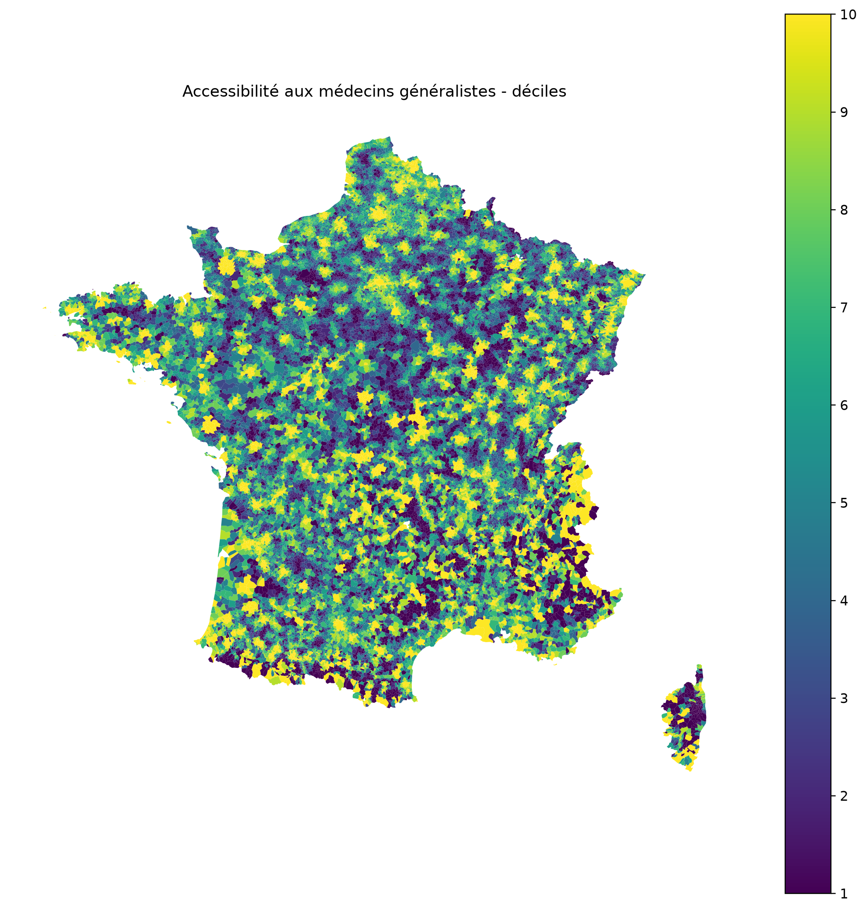
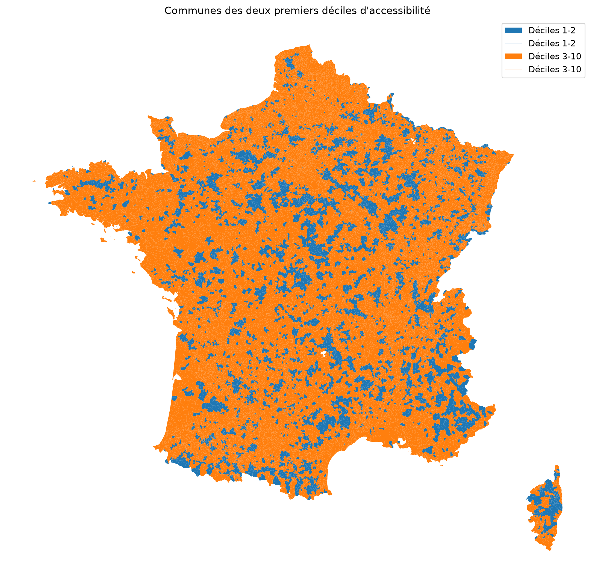
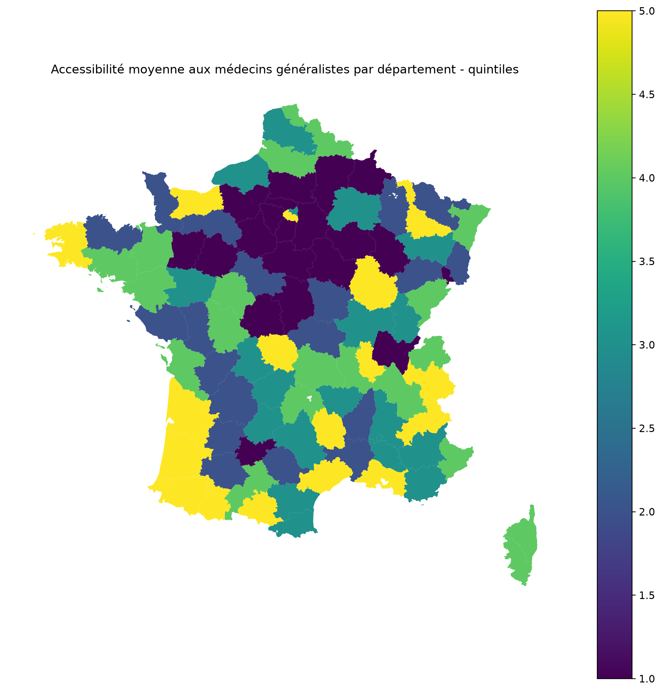

## Accessibilité communale

{width=92%}

La représentation en classes permet de comparer plus facilement les communes entre elles sans laisser quelques valeurs extrêmes dominer l’échelle graphique.

## Communes des deux premiers déciles

{width=92%}

Cette carte met en évidence les communes appartenant aux deux premiers déciles de l’indicateur ajusté.

## Accessibilité moyenne par département

{width=88%}

## Carte interactive

Passez la souris sur une commune pour afficher ses principales caractéristiques.

<iframe
  class="map-frame"
  src="src/outputs/cartes/carte_accessibilite_interactive.html"
  title="Carte interactive de l'accessibilité aux médecins généralistes">
</iframe>
