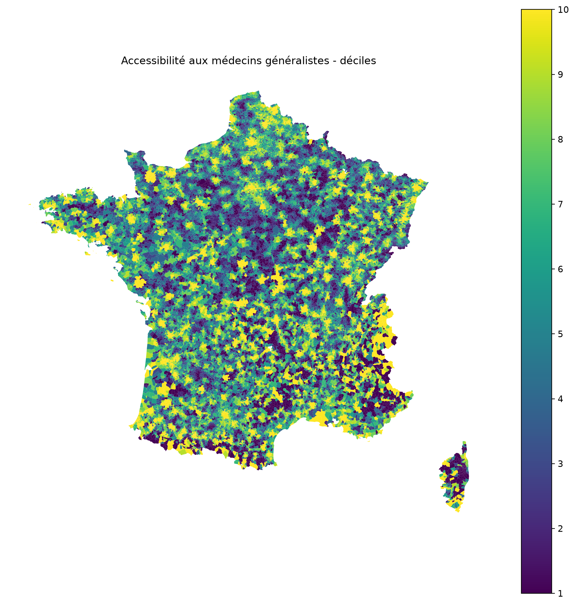

::: {.hero}
# Les médecins sont-ils réellement accessibles là où vivent les habitants ?

Ce projet analyse les **inégalités territoriales d’accès aux médecins généralistes en France** à l’échelle communale.

Plutôt que de compter uniquement les médecins présents dans chaque commune, nous construisons un indicateur tenant compte de **l’offre médicale accessible autour de la commune, du temps de trajet routier, de la population en concurrence pour cette offre et de la structure par âge**.
:::

::: {.cards}
::: {.card-mini}
**34 858 communes**

Une analyse menée à l’échelle communale pour conserver une lecture fine des disparités territoriales.
:::

::: {.card-mini}
**20 minutes**

Les communes accessibles par la route en moins de 20 minutes sont intégrées dans le calcul.
:::

::: {.card-mini}
**Indicateur ajusté**

La demande est corrigée selon la structure d’âge afin de mieux représenter les besoins potentiels en soins.
:::
:::

## Une accessibilité différente de la simple densité médicale

Une commune peut ne compter aucun médecin généraliste tout en bénéficiant d’une bonne accessibilité si des médecins sont facilement accessibles dans les communes voisines.

À l’inverse, la présence de médecins dans une commune ne garantit pas une bonne accessibilité si cette offre doit répondre à une demande importante provenant de plusieurs territoires.

## Vue d’ensemble

{fig-alt="Carte de l'accessibilité aux médecins généralistes en France métropolitaine" width=90%}

La carte représente la position relative des communes selon leur accessibilité aux médecins généralistes.

## Les données mobilisées

- **INSEE** : population, âge, niveau de vie, pauvreté et densité territoriale ;
- **RPPS** : médecins généralistes et communes d’exercice ;
- **FINESS / SYGEN** : établissements, capacités hospitalières et équipements ;
- **réseau routier** : distances et temps de trajet entre communes.

## Explorer le projet

- [Comprendre la construction de l’indicateur](methodologie.qmd)
- [Consulter les principaux résultats](resultats.qmd)
- [Étudier les inégalités territoriales](inegalites.qmd)
- [Explorer les cartes](cartes.qmd)
