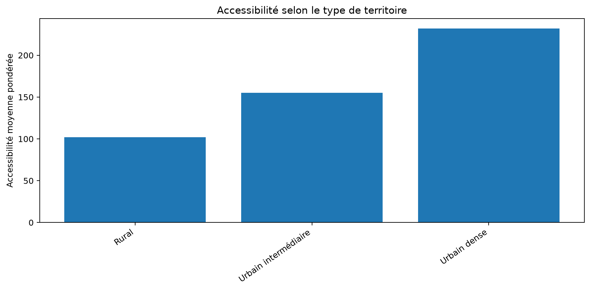
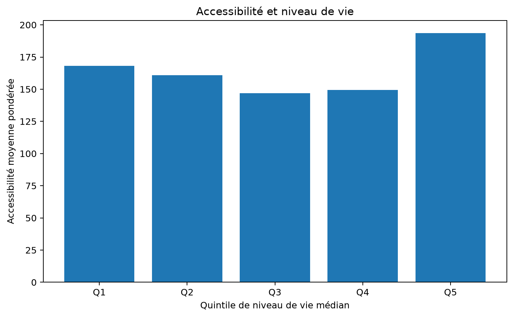
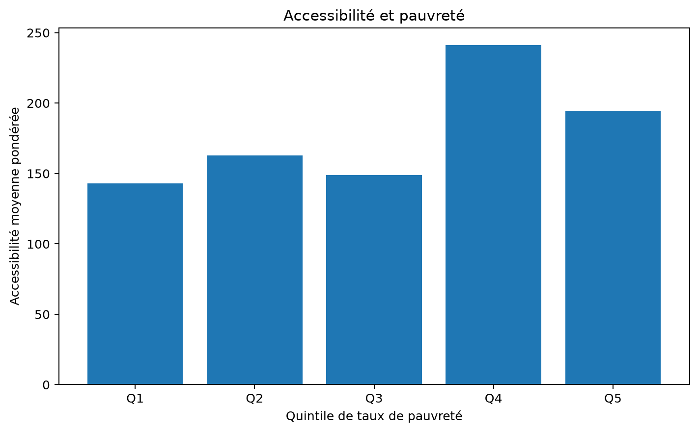
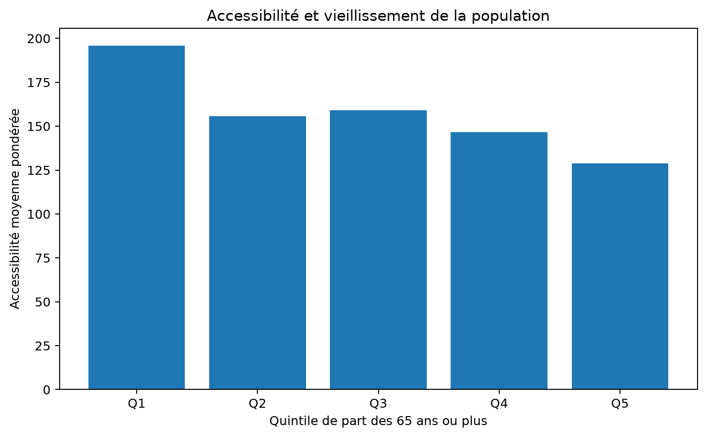
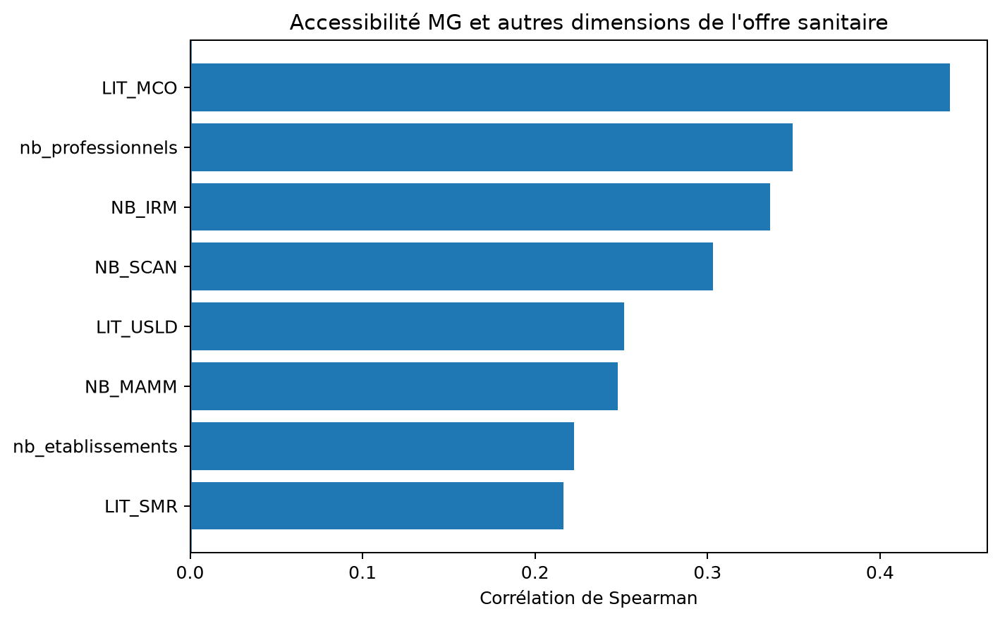
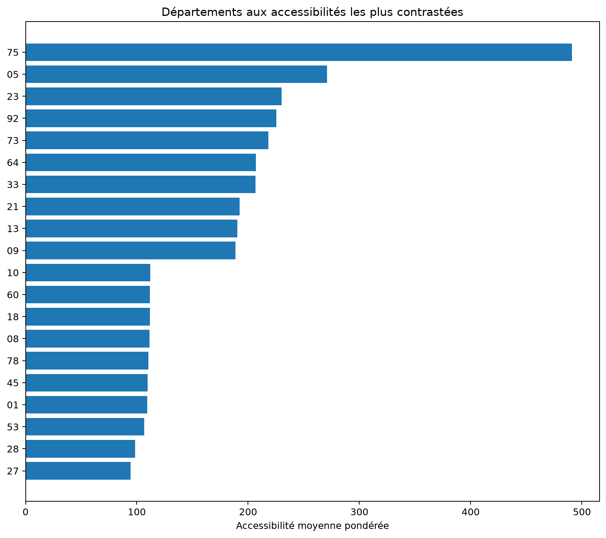

## Densité territoriale

{width=80%}

L’accessibilité peut être comparée entre territoires selon leur niveau de densité afin d’identifier les différences entre espaces urbains, intermédiaires et ruraux.

## Niveau de vie

{width=78%}

## Pauvreté

{width=78%}

## Vieillissement de la population

{width=78%}

## Accessibilité et offre sanitaire

{width=82%}

Cette analyse étudie les associations entre l’accessibilité aux médecins généralistes et différentes dimensions de l’offre sanitaire.

::: {.callout-warning}
Ces résultats sont **descriptifs**. Une corrélation observée entre deux variables ne permet pas de conclure à une relation causale.
:::

## Disparités départementales

{width=82%}
