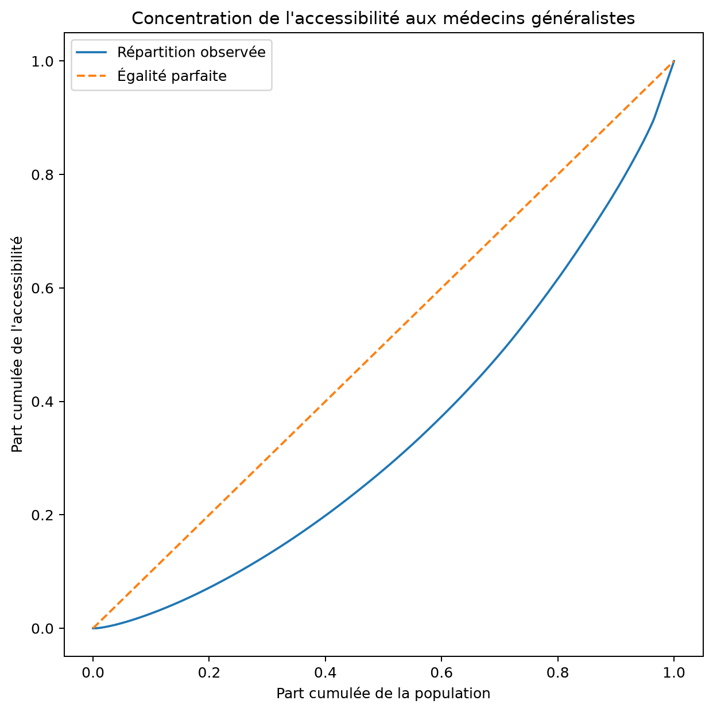
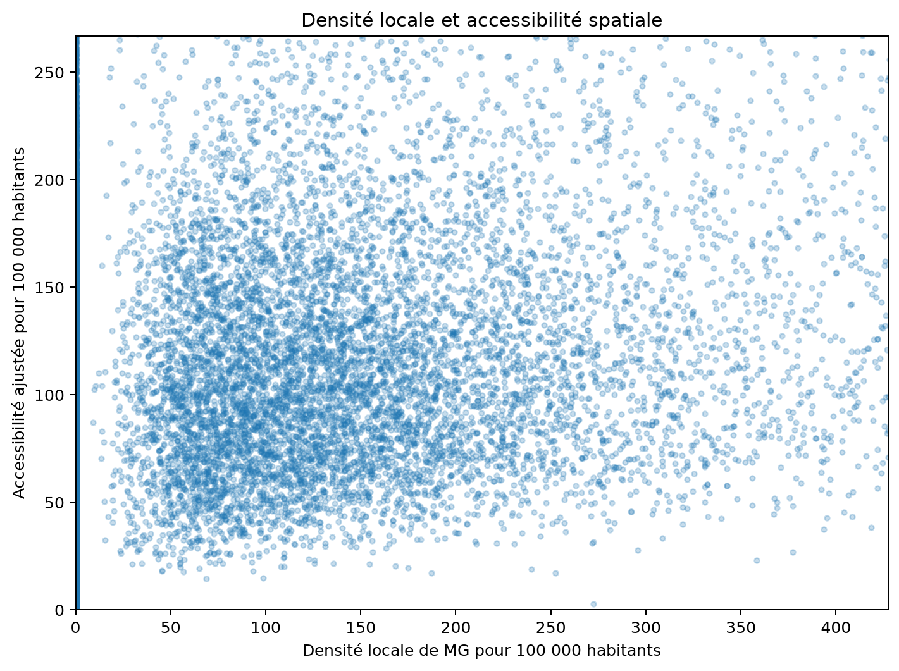

## Une distribution inégale de l’accessibilité

{width=78%}

La distribution de l’accessibilité met en évidence des écarts importants entre communes.

## Densité médicale locale et accessibilité spatiale

{width=78%}

La densité locale et l’accessibilité spatiale ne mesurent pas exactement la même chose.

Une commune sans médecin peut bénéficier des médecins situés à proximité, tandis qu’une commune disposant d’une offre locale peut subir une forte pression de la demande environnante.

## L’effet de la structure par âge

L’indicateur ajusté tient compte de la structure d’âge de la population. Cet ajustement modifie donc la position relative de certaines communes lorsqu’elles présentent des besoins potentiels plus élevés.

## Identifier les territoires les moins accessibles

Le classement en déciles permet de repérer les communes se situant dans le bas de la distribution nationale.

Ces communes sont décrites comme ayant une **faible accessibilité relative** dans le cadre de ce projet.

Cette notion ne constitue pas une définition officielle de « désert médical ».
